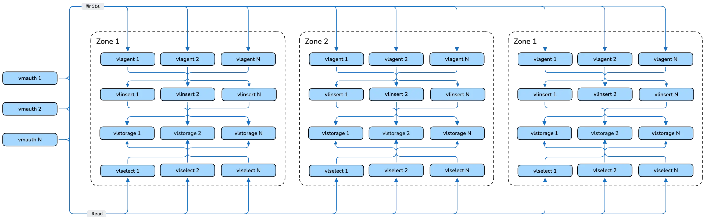

`VLDistributed` is the Custom Resource Definition for orchestrated updates of several VictoriaLogs clusters or single-node instances. It allows you to define and manage components of a distributed VictoriaLogs setup and apply changes to them sequentially, ensuring high availability and minimal disruption.

**Note:** `VLDistributed` is an experimental feature and may not be suitable for production environments. The API is not yet stable and may change in future releases.



For a high-level overview of VictoriaLogs distributed architecture, refer to the official [VictoriaLogs cluster documentation](https://docs.victoriametrics.com/victorialogs/cluster/).

## Specification

The `VLDistributed` resource allows you to configure various aspects of your VictoriaLogs distributed setup. The specification includes:

*   `retain`: If set to `true`, the operator will keep managed components during VLDistributed CR removal.
*   `paused`: If set to `true`, the operator will not perform any actions on the underlying managed objects, except removing the `VLDistributed` itself. Useful for temporarily halting reconciliation.
*   `backendType`: Specifies the backend type for **all** zones. Either `VLCluster` (default) or `VLSingle`. All zones must use the same backend type.
*   `vmauth`: Configuration for a `VMAuth` instance that acts as a proxy/load-balancer for read and write access to the managed VictoriaLogs backends. Its name defaults to the `VLDistributed` name. Set `vmauth.enabled: false` to skip creating it.
*   `zoneCommon`: Defines `VLDistributedZoneCommon` common zone configuration, which is default for each zone resource.
*   `zones`: Defines the list of `VLDistributedZone` that form the distributed setup.
*   `license`: Configures the license key for enterprise features. If provided, it is automatically passed to the managed `VMAuth`, all `VLAgent`, `VLCluster`, and `VLSingle` instances, unless they set their own `license`.

### `VLDistributedZoneCommon`

Every field except `readyTimeout` and `updatePause` is a default for each zone and can use the `%ZONE%` placeholder. Values set in a zone are merged on top of it.

*   `vlcluster`: Default `VLDistributedZoneCluster` for each zone. Must not be set when `spec.backendType: VLSingle`.
*   `vlsingle`: Default `VLDistributedZoneSingle` for each zone. Must not be set when `spec.backendType: VLCluster`.
*   `vlagent`: Default `VLDistributedZoneAgent` for each zone. Its `spec` supports a subset of `VLAgentSpec` fields. Remote write targets are managed by the operator; use `remoteWrite` below for their settings.
*   `remoteWrite`: Default remote write settings that every zone's `vlagent` uses to write to the zone's backend: `basicAuth`, `bearerTokenSecret`, `bearerTokenPath`, `oauth2`, `tlsConfig`, `sendTimeout`, `headers`, `maxDiskUsage` and `proxyURL`. The URL is set by the operator.
*   `readyTimeout`: The readiness timeout for each zone update. Default is `5m`.
*   `updatePause`: Time the operator should wait between zone updates to ensure a smooth transition. Default is `1m`.

### `VLDistributedZone`

Each entry in the `zones` array includes:

*   `name` defines the zone name. It is used for default per-zone resource names and replaces the `%ZONE%` placeholder in `zoneCommon`.
*   `trafficMode` controls which traffic `vmauth` routes to the zone:
    *   `read-write` (default when unset): the zone serves reads and writes.
    *   `read-only`: the zone is removed from the `write` backend. For `VLCluster`, `vlinsert` is scaled to 0, so `vlagent` buffers the zone's data until writes are enabled again.
    *   `write-only`: the zone is removed from the `read` backend.
    *   `maintenance`: the zone is removed from both backends, and `vlinsert` is scaled to 0 like in `read-only`.
*   `vlcluster` defines `VLDistributedZoneCluster`, which either references an existing `VLCluster` resource or creates a new one. Must not be set when `spec.backendType: VLSingle`.
*   `vlsingle` defines `VLDistributedZoneSingle`, which either references an existing `VLSingle` resource or creates a new one. Must not be set when `spec.backendType: VLCluster`.
*   `vlagent` defines `VLDistributedZoneAgent`, which either references an existing `VLAgent` resource or creates a new one. It receives write traffic from `vmauth` and sends it to the `VLCluster` or `VLSingle` of every zone.
*   `remoteWrite` overrides `zoneCommon.remoteWrite` for writes to this zone's backend, from every zone's `vlagent`.

### `VLDistributedZoneCluster`

*   `name`: Optional name of an existing `VLCluster` or one to be created; when omitted it defaults to `zoneCommon.vlcluster.name` (where `%ZONE%` is used to template the zone name) or `${cr.Name}-${zone.name}` when unset.
*   `spec`: A `VLClusterSpec` object that defines the desired state of a new or referenced `VLCluster` managed by this resource.

### `VLDistributedZoneSingle`

*   `name`: Optional name of an existing `VLSingle` or one to be created; when omitted it defaults to `zoneCommon.vlsingle.name` (where `%ZONE%` is used to template the zone name) or `${cr.Name}-${zone.name}` when unset.
*   `spec`: A `VLSingleSpec` object that defines the desired state of a new or referenced `VLSingle` managed by this resource.

**Example: Defining a `VLDistributed` resource with `VLCluster` backend:**

```yaml
apiVersion: operator.victoriametrics.com/v1alpha1
kind: VLDistributed
metadata:
  name: my-distributed-logs
spec:
  vmauth:
    name: my-distributed-vmauth
    spec:
      replicaCount: 1
      unauthorizedUserAccessSpec:
        targetRefs:
          - name: read
          - name: write
  zoneCommon:
    vlagent:
      spec:
        replicaCount: 1
    vlcluster:
      spec:
        vlstorage:
          replicaCount: 1
        vlselect:
          replicaCount: 1
        vlinsert:
          replicaCount: 1
  zones:
    - name: zone-a
    - name: zone-b
      vlcluster:
        spec:
          vlselect:
            replicaCount: 2
```

**Example: Defining a `VLDistributed` resource with `VLSingle` backend:**

```yaml
apiVersion: operator.victoriametrics.com/v1alpha1
kind: VLDistributed
metadata:
  name: my-distributed-log-singles
spec:
  backendType: VLSingle
  vmauth:
    name: my-distributed-vmauth
    spec:
      replicaCount: 1
      unauthorizedUserAccessSpec:
        targetRefs:
          - name: read
          - name: write
  zoneCommon:
    vlagent:
      spec:
        replicaCount: 1
    vlsingle:
      spec:
        retentionPeriod: "30d"
  zones:
    - name: zone-a
    - name: zone-b
      vlsingle:
        spec:
          retentionPeriod: "14d"
```

### Ownership and references

`VLDistributed` creates or becomes an owner of existing `VMAuth`, `VLAgent`, `VLCluster`, and `VLSingle` resources and by default it removes all resources it owns on CR deletion. To remove `VLDistributed` but keep all owned resources set `spec.retain: true` before `VLDistributed` removal.

When a zone references an existing `VLAgent`, `VLCluster` or `VLSingle` by name, `VLDistributed` takes ownership of it and replaces its spec with the one built from `zoneCommon` and the zone. Fields that are set only on the existing object are lost.

### Current shortcomings

- Only one `VMAuth` can be managed per `VLDistributed`.
- All objects must belong to the same namespace as the `VLDistributed`.
- Objects must be referred to by name; label selectors are not supported for `VMAuth`, `VLAgent`, `VLCluster` or `VLSingle` selection.
- `VLAgent`, `VLCluster` and `VLSingle` names must be unique across zones within one `VLDistributed` resource.
- All zones must use the same backend type (controlled by `spec.backendType`); mixing `VLCluster` and `VLSingle` zones in one `VLDistributed` is not supported.

### Authorization

By default, the `VMAuth` created by `VLDistributed` is not open: it rejects all read and write requests. This is on purpose. Opening it to everyone would let anyone who can reach it read and write data, and creating a default user would mean the operator picks a username, password and permissions for you. So you decide how clients get access.

The operator gives the `VMAuth` two named backends: `read` sends queries to the zones, and `write` sends data to the zones. To open access, list them in `targetRefs` in one of two ways:

*   **Anonymous access**: no username or password. Simple, and fine for testing or a trusted network.
*   **Access with credentials**: through `VMUser` objects. Each client needs a username and password, and can be given only `read` or only `write`.

#### Anonymous access

Reference both backends in `spec.vmauth.spec.unauthorizedUserAccessSpec`:

```yaml
spec:
  vmauth:
    spec:
      unauthorizedUserAccessSpec:
        targetRefs:
          - name: read
          - name: write
```

Any client that can reach the `VMAuth` service can now read and write without credentials.

#### Access with credentials

Leave `unauthorizedUserAccessSpec` unset and make the `VMAuth` select `VMUser` objects, either with `selectAllByDefault: true` or with [user selectors](https://docs.victoriametrics.com/operator/resources/vmauth/#users):

```yaml
spec:
  vmauth:
    spec:
      selectAllByDefault: true
```

Then create a `VMUser` for each client and reference the backends it may use in `targetRefs`:

```yaml
apiVersion: operator.victoriametrics.com/v1beta1
kind: VMUser
metadata:
  name: example
spec:
  username: simple-user
  password: simple-password
  targetRefs:
    - name: read
    - name: write   # omit for a read-only client
```
