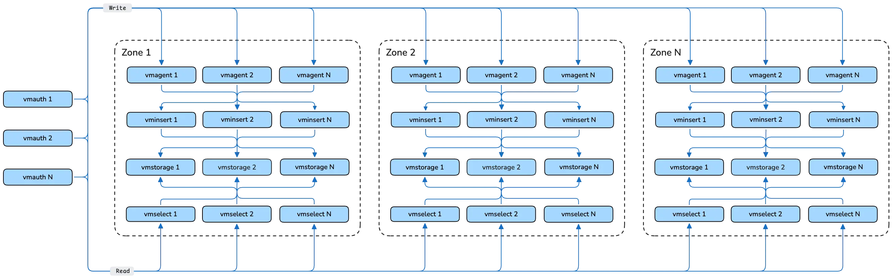

`VMDistributed` is the Custom Resource Definition for orchestrated updates of several VictoriaMetrics clusters or single-node instances. It allows you to define and manage components of a distributed VictoriaMetrics setup and apply changes to them sequentially, ensuring high availability and minimal disruption.

**Note:** `VMDistributed` is an experimental feature and may not be suitable for production environments. The API is not yet stable and may change in future releases.



For a high-level overview of VictoriaMetrics distributed cluster architecture, refer to the official [VictoriaMetrics documentation](https://docs.victoriametrics.com/victoriametrics/cluster-victoriametrics/).

## Specification

The `VMDistributed` resource allows you to configure various aspects of your VictoriaMetrics distributed cluster. The specification includes:

*   `retain`: If set to `true`, the operator will keep managed components during VMDistributed CR removal.
*   `paused`: If set to `true`, the operator will not perform any actions on the underlying managed objects, except removing the `VMDistributed` itself. Useful for temporarily halting reconciliation.
*   `backendType`: Specifies the backend type for **all** zones. Either `VMCluster` (default) or `VMSingle`. All zones must use the same backend type.
*   `vmauth`: Configuration for a `VMAuth` instance that acts as a proxy/load-balancer for the `vmselect` (or `VMSingle`) and `vmagent` components of the managed zones. It acts as a global read and write path entry point. Its name defaults to the `VMDistributed` name. Set `vmauth.enabled: false` to skip creating it.
*   `zoneCommon`: Defines `VMDistributedZoneCommon` common zone configuration, which is default for each zone resource.
*   `zones`: Defines the list of `VMDistributedZone` that form the distributed setup.
*   `license`: Configures the license key for enterprise features. If provided, it is automatically passed to the managed `VMAuth`, all `VMAgent`, `VMCluster`, and `VMSingle` instances, unless they set their own `license`.

### `VMDistributedZoneCommon`

Every field except `readyTimeout` and `updatePause` is a default for each zone and can use the `%ZONE%` placeholder. Values set in a zone are merged on top of it.

*   `vmcluster`: Default `VMDistributedZoneCluster` for each zone. Must not be set when `spec.backendType: VMSingle`.
*   `vmsingle`: Default `VMDistributedZoneSingle` for each zone. Must not be set when `spec.backendType: VMCluster`.
*   `vmagent`: Default `VMDistributedZoneAgent` for each zone. Its `spec` supports a subset of `VMAgentSpec` fields. Remote write targets are managed by the operator; use `remoteWrite` below for their settings.
*   `remoteWrite`: Default remote write settings that every zone's `vmagent` uses to write to the zone's backend, for example `basicAuth`, `tlsConfig`, `sendTimeout` and `headers`. See [`VMDistributedZoneRemoteWriteSpec`](https://docs.victoriametrics.com/operator/api/#v1alpha1-vmdistributedzoneremotewritespec) for all fields. The URL is set by the operator.
*   `readyTimeout`: The readiness timeout for each zone update. Default is `5m`.
*   `updatePause`: Time the operator should wait between zone updates to ensure a smooth transition. Default is `1m`.

### `VMDistributedZone`

Each entry in the `zones` array includes:

*   `name` defines the zone name. It is used for default per-zone resource names and replaces the `%ZONE%` placeholder in `zoneCommon`.
*   `trafficMode` controls which traffic `vmauth` routes to the zone:
    *   `read-write` (default when unset): the zone serves reads and writes.
    *   `read-only`: the zone is removed from the `write` backend. For `VMCluster`, `vminsert` is scaled to 0, so `vmagent` buffers the zone's data until writes are enabled again.
    *   `write-only`: the zone is removed from the `read` backend.
    *   `maintenance`: the zone is removed from both backends, and `vminsert` is scaled to 0 like in `read-only`.
*   `vmcluster` defines `VMDistributedZoneCluster`, which either references an existing `VMCluster` resource or creates a new one. Must not be set when `spec.backendType: VMSingle`.
*   `vmsingle` defines `VMDistributedZoneSingle`, which either references an existing `VMSingle` resource or creates a new one. Must not be set when `spec.backendType: VMCluster`.
*   `vmagent` defines `VMDistributedZoneAgent`, which either references an existing `VMAgent` resource or creates a new one. It receives write traffic from `vmauth` and sends it to the `VMCluster` or `VMSingle` of every zone.
*   `remoteWrite` overrides `zoneCommon.remoteWrite` for writes to this zone's backend, from every zone's `vmagent`.

### `VMDistributedZoneCluster`

*   `name`: Optional name of an existing `VMCluster` or one to be created; when omitted it defaults to `zoneCommon.vmcluster.name` (where `%ZONE%` is used to template the zone name) or `${cr.Name}-${zone.name}` when unset.
*   `spec`: A `vmv1beta1.VMClusterSpec` object that defines the desired state of a new or referenced `VMCluster` managed by this resource.

### `VMDistributedZoneSingle`

*   `name`: Optional name of an existing `VMSingle` or one to be created; when omitted it defaults to `zoneCommon.vmsingle.name` (where `%ZONE%` is used to template the zone name) or `${cr.Name}-${zone.name}` when unset.
*   `spec`: A `vmv1beta1.VMSingleSpec` object that defines the desired state of a new or referenced `VMSingle` managed by this resource.

**Example: Defining a `VMDistributed` resource with `VMCluster` backend:**

```yaml
apiVersion: operator.victoriametrics.com/v1alpha1
kind: VMDistributed
metadata:
  name: my-distributed-cluster
spec:
  vmauth:
    name: my-distributed-vmauth
    spec:
      replicaCount: 1
      unauthorizedUserAccessSpec:
        targetRefs:
          - name: read
          - name: write
  zoneCommon:
    vmagent:
      spec:
        replicaCount: 1
    vmcluster:
      spec:
        vmstorage:
          replicaCount: 1
          storage:
            volumeClaimTemplate:
              spec:
                resources:
                  requests:
                    storage: 10Gi
        vmselect:
          replicaCount: 1
        vminsert:
          replicaCount: 1
  zones:
    - name: zone-a
    - name: zone-b
      vmcluster:
        spec:
          vmselect:
            replicaCount: 2
```

**Example: Defining a `VMDistributed` resource with `VMSingle` backend:**

```yaml
apiVersion: operator.victoriametrics.com/v1alpha1
kind: VMDistributed
metadata:
  name: my-distributed-singles
spec:
  backendType: VMSingle
  vmauth:
    name: my-distributed-vmauth
    spec:
      replicaCount: 1
      unauthorizedUserAccessSpec:
        targetRefs:
          - name: read
          - name: write
  zoneCommon:
    vmagent:
      spec:
        replicaCount: 1
    vmsingle:
      spec:
        retentionPeriod: "30d"
  zones:
    - name: zone-a
    - name: zone-b
      vmsingle:
        spec:
          retentionPeriod: "14d"
```

**Example: Defining a `VMDistributed` resource with Kubernetes nodeSelectors:**

This example pins each zone's `vmagent` and `vmsingle` to nodes with the matching
[`topology.kubernetes.io/zone`](https://kubernetes.io/docs/reference/labels-annotations-taints/#topologykubernetesiozone) label.
Any node label works the same way, see [Assign Pods to Nodes](https://kubernetes.io/docs/tasks/configure-pod-container/assign-pods-nodes/).
For each zone, the operator replaces `%ZONE%` with that zone's `name`.
In this example, `zone-a` and `zone-b` pods are scheduled only on nodes labeled `topology.kubernetes.io/zone: zone-a` and `topology.kubernetes.io/zone: zone-b`.

`vmauth` has no `nodeSelector`, so it can run on any node and keeps serving traffic if a zone goes down.

```yaml
apiVersion: operator.victoriametrics.com/v1alpha1
kind: VMDistributed
metadata:
  name: my-distributed-vmsingles
spec:
  backendType: VMSingle
  vmauth:
    name: my-distributed-vmauth
    spec:
      replicaCount: 2
      unauthorizedUserAccessSpec:
        targetRefs:
          - name: read
          - name: write
  zoneCommon:
    vmagent:
      spec:
        replicaCount: 1
        nodeSelector:
          topology.kubernetes.io/zone: "%ZONE%"
    vmsingle:
      spec:
        nodeSelector:
          topology.kubernetes.io/zone: "%ZONE%"
        retentionPeriod: "30d"
  zones:
    - name: zone-a
    - name: zone-b
```

### VMDistributed and distributed chart

VMDistributed can be used alongside the resources created by the distributed chart. The distributed chart provides a convenient way to create multiple `VMCluster` objects and surrounding resources.

In order to update VMClusters in a coordinated manner, add VMCluster resources to the `zones` list:

```yaml
spec:
  vmauth:
    spec:
      replicaCount: 1
      unauthorizedUserAccessSpec:
        targetRefs:
          - name: read
          - name: write
  zoneCommon:
    vmagent:
      name: vmagent-%ZONE%
      spec:
        replicaCount: 1
    vmcluster:
      name: vmcluster-%ZONE%
      spec:
        replicationFactor: 1
        requestsLoadBalancer:
          enabled: true
          spec:
            nodeSelector:
              kubernetes.io/os: linux
            replicaCount: 2
            topologySpreadConstraints:
            - maxSkew: 1
              topologyKey: kubernetes.io/hostname
              whenUnsatisfiable: ScheduleAnyway
        retentionPeriod: "14d"
        vminsert:
          nodeSelector:
            kubernetes.io/os: linux
          port: "8480"
          replicaCount: 2
          topologySpreadConstraints:
          - maxSkew: 1
            topologyKey: kubernetes.io/hostname
            whenUnsatisfiable: ScheduleAnyway
        vmselect:
          nodeSelector:
            kubernetes.io/os: linux
          port: "8481"
          replicaCount: 2
          topologySpreadConstraints:
          - maxSkew: 1
            topologyKey: kubernetes.io/hostname
            whenUnsatisfiable: ScheduleAnyway
        vmstorage:
          nodeSelector:
            kubernetes.io/os: linux
          replicaCount: 2
          storageDataPath: /vm-data
          topologySpreadConstraints:
          - maxSkew: 1
            topologyKey: kubernetes.io/hostname
            whenUnsatisfiable: ScheduleAnyway
  zones:
    - name: central
    - name: east
    - name: west
```

Note that VMDistributed will create a single VMAuth, which encapsulates rules for both read and write access to the zones, unlike the distributed chart which creates separate VMAuths for read and write paths. This provides a convenient way to migrate the traffic between VMDistributed and distributed helm chart implementations.

### Ownership and references

VMDistributed creates or becomes an owner of existing VMAuth, VMAgent, VMCluster and VMSingle resources and by default it removes all resources it owns on CR deletion. To remove VMDistributed but keep all owned resources set `spec.retain: true` before VMDistributed removal.

When a zone references an existing `VMAgent`, `VMCluster` or `VMSingle` by name, VMDistributed takes ownership of it and replaces its spec with the one built from `zoneCommon` and the zone. Fields that are set only on the existing object are lost.

### Current shortcomings

- Only one `VMAuth` can be managed per `VMDistributed`.
- All objects must belong to the same namespace as the `VMDistributed`.
- Objects must be referred to by name; label selectors are not supported for `VMAuth`, `VMAgent`, `VMCluster` or `VMSingle` selection.
- `VMAgent`, `VMCluster` and `VMSingle` names must be unique across zones within one `VMDistributed` resource.
- All zones must use the same backend type (controlled by `spec.backendType`); mixing `VMCluster` and `VMSingle` zones in one `VMDistributed` is not supported.

### Authorization

By default, the `VMAuth` created by `VMDistributed` is not open: it rejects all read and write requests. This is on purpose. Opening it to everyone would let anyone who can reach it read and write data, and creating a default user would mean the operator picks a username, password and permissions for you. So you decide how clients get access.

The operator gives the `VMAuth` two named backends: `read` sends queries to the zones, and `write` sends data to the zones. To open access, list them in `targetRefs` in one of two ways:

*   **Anonymous access**: no username or password. Simple, and fine for testing or a trusted network.
*   **Access with credentials**: through `VMUser` objects. Each client needs a username and password, and can be given only `read` or only `write`.

#### Anonymous access

Reference both backends in `spec.vmauth.spec.unauthorizedUserAccessSpec`:

```yaml
spec:
  vmauth:
    spec:
      unauthorizedUserAccessSpec:
        targetRefs:
          - name: read
          - name: write
```

Any client that can reach the `VMAuth` service can now read and write without credentials.

#### Access with credentials

Leave `unauthorizedUserAccessSpec` unset and make the `VMAuth` select `VMUser` objects, either with `selectAllByDefault: true` or with [user selectors](https://docs.victoriametrics.com/operator/resources/vmauth/#users):

```yaml
spec:
  vmauth:
    spec:
      selectAllByDefault: true
```

Then create a `VMUser` for each client and reference the backends it may use in `targetRefs`:

```yaml
apiVersion: operator.victoriametrics.com/v1beta1
kind: VMUser
metadata:
  name: example
spec:
  username: simple-user
  password: simple-password
  targetRefs:
    - name: read
    - name: write   # omit for a read-only client
```
